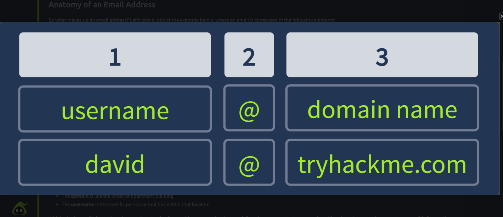
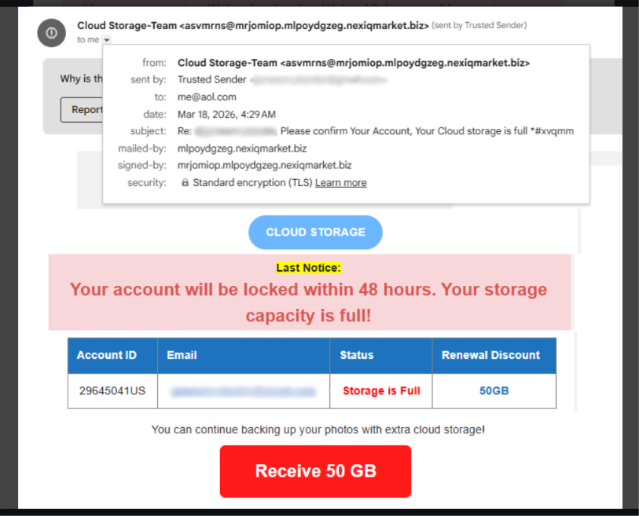
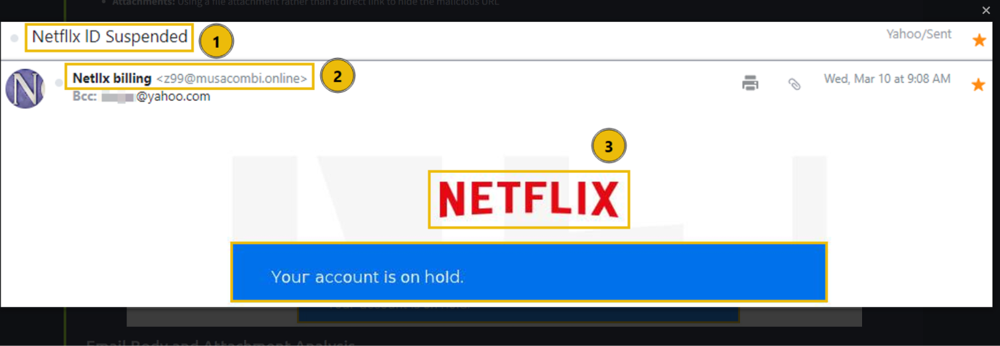
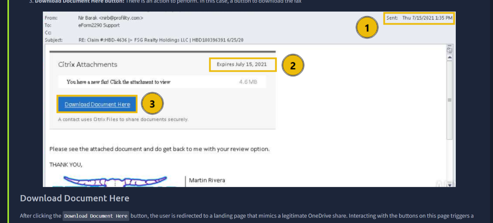
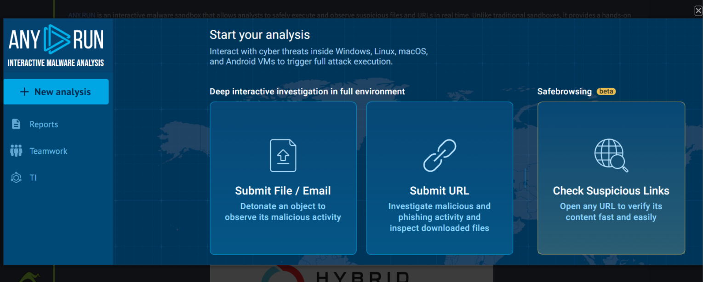
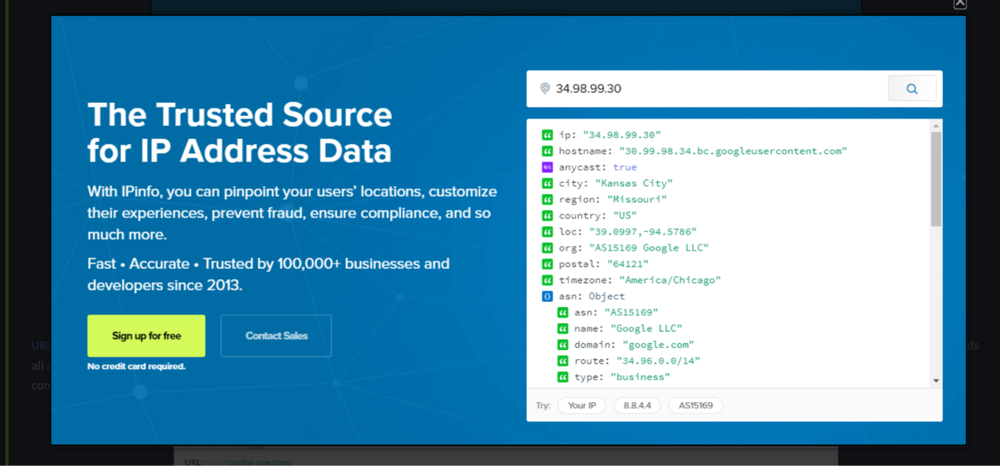
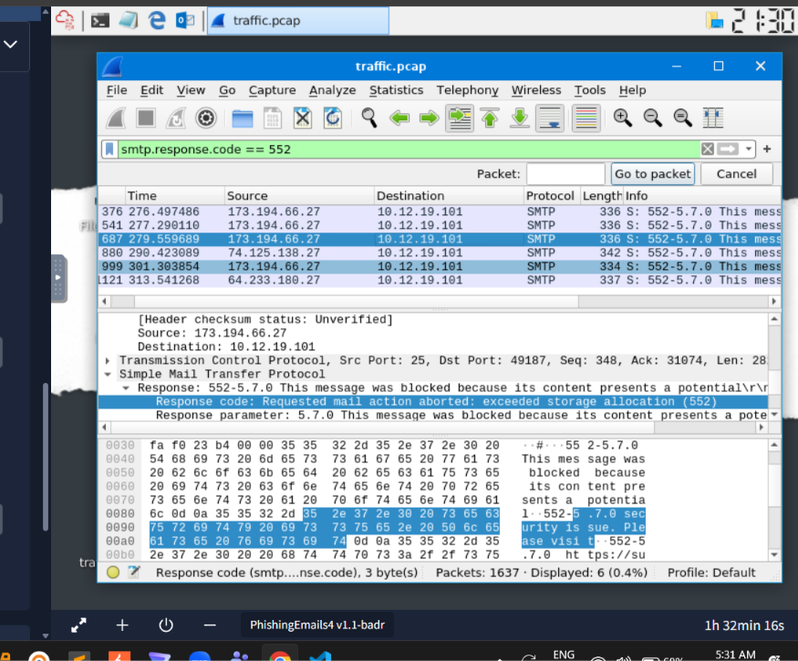
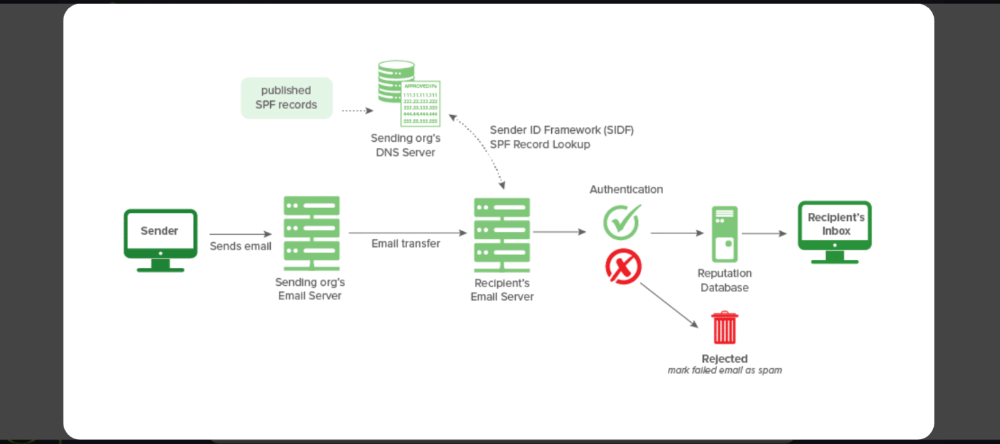

# TryHackMe: Phishing Analysis

## Overview

Comprehensive phishing email analysis training covering multiple rooms with hands-on investigation techniques.

## Topics Covered

### **Phishing Analysis Fundementals**

*Key concepts:* Email Delivery, Email Headers/Body, Types of Phishing

**What I learned:**

- **Anatomy of an Email Address:** Emails contains username and domain seperated by @
- **Email Delivery:** SMTP sends email, POP3 downloads email to a device, IMAP syncs email across devices
- **Types of Phishing:** Spam, Phishing, Spear Phishing, Whaling, Smishing, Vishing
- **Characteristics of Phishing Email:** Spoofed From Address, Urgent Message, Brand impersonation, Grammar & Spelling Issues, Generic Content, Hidden or Shortened Link and Malicious Attachments

**Email Structure Example**

**Phishing Email Example**

---

### Phishing Emails in Action

*Key concepts:* Phishing indicators, examine actual phishing emails

**What I learned**

- **Types of actual phishing attempts:** Cancel Order, Track Your Package, Your Account is on Hold
- **How to investigate emails:** Identifying common red flags like spelling issue and urgency

**Your Account is on Hold**

**Download Document Here**

---

### Phishing Analysis Tool

*Key concepts:* Tools for phishing analysis, investigate suspicious email

**What I learned**
- **Tools use for phishing analysis:** ANYRUN, IPinfo and Phishtool

**ANYRUN**

**IPinfo**

---

### Phishing Prevention

*Key concepts:* Phishing prevention, Frameworks to reduce phishing

**What I learned**
- **How to prevent phishing**: Implementing security measures
- **Security frameworks**: SPF, DKIM, DMARC and S/MIME

**Investigating SMTP response**

**SPF**

---