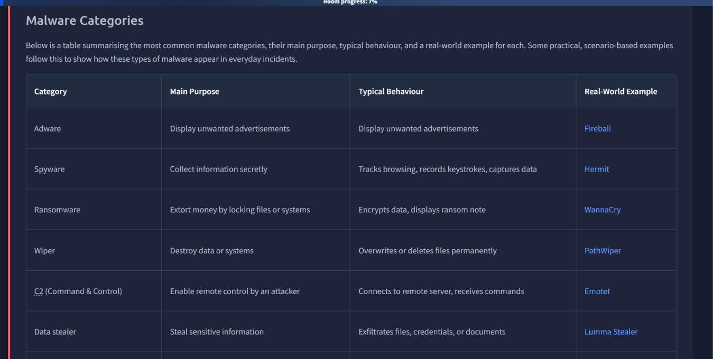
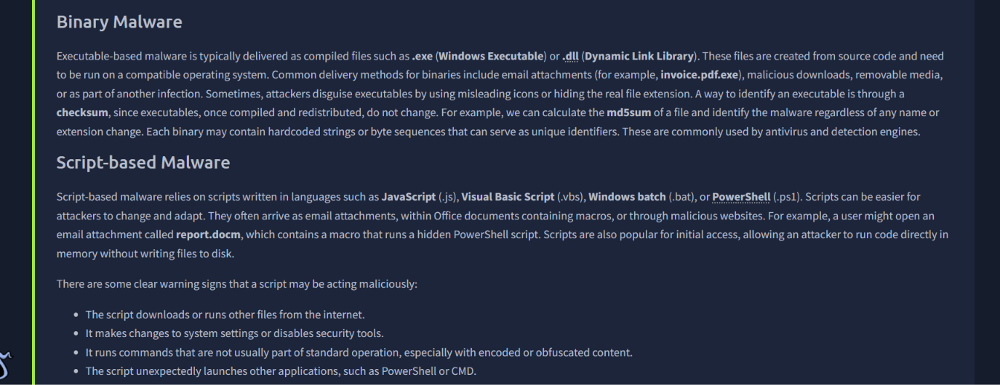
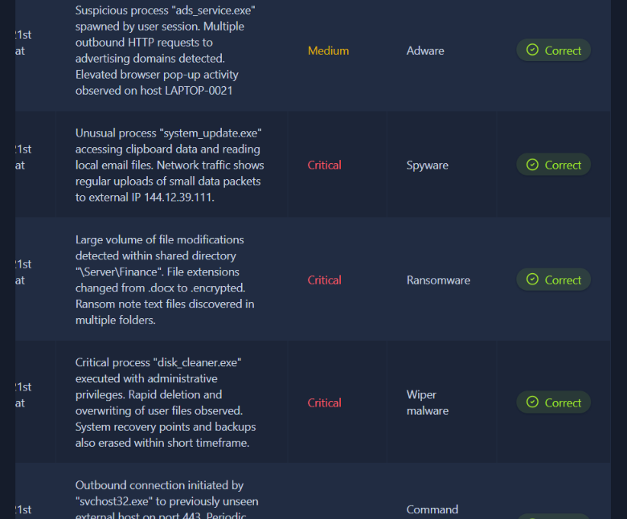
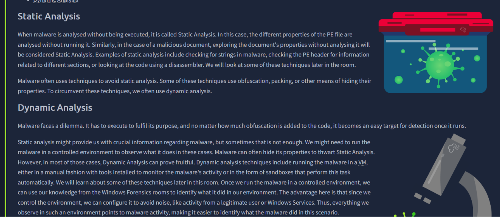
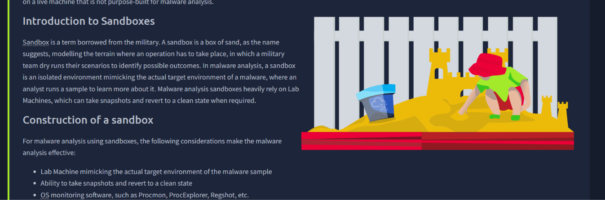
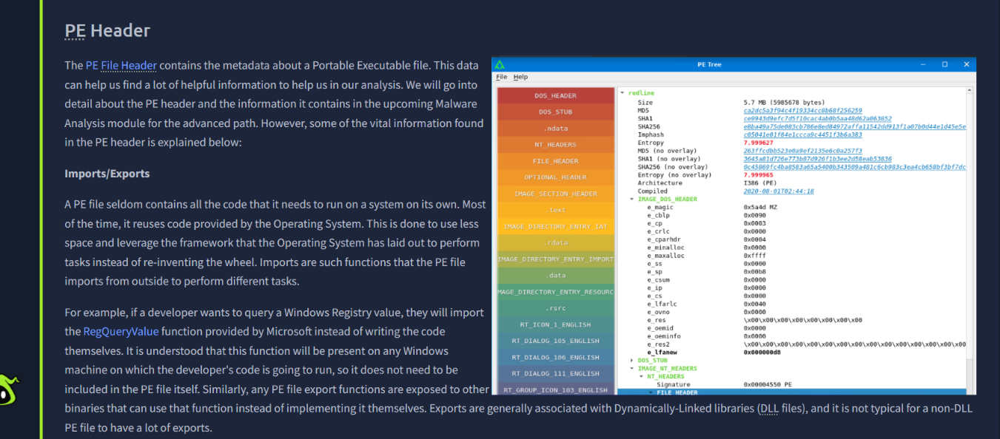
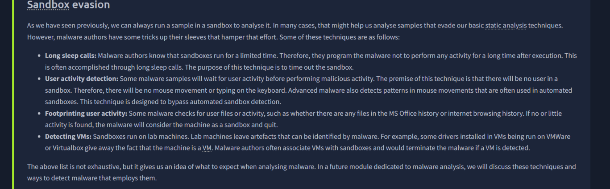
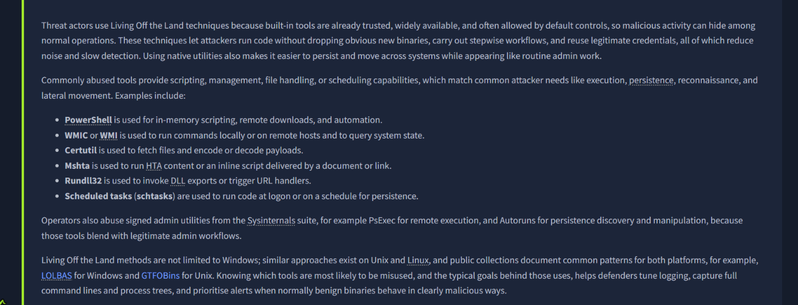
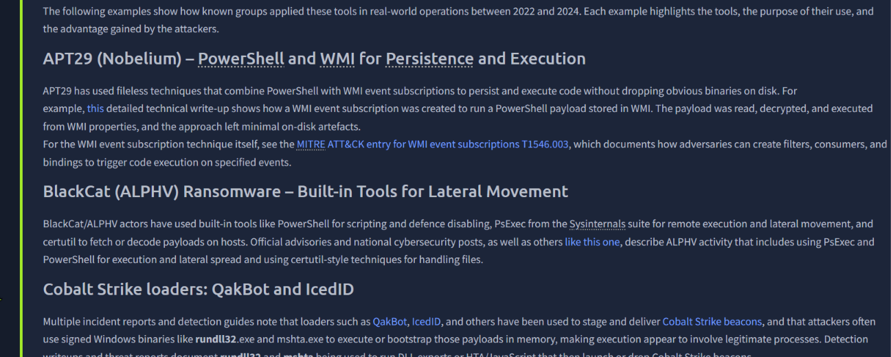
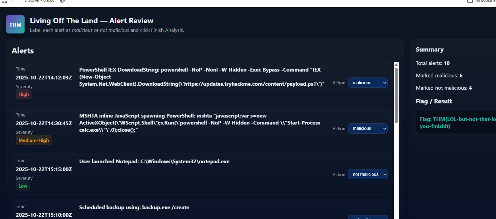

# Malware Classification

## Overview
Comprehensive training of malware analysis. Hands-on experience in identifying types of malware, how to defend against them and what to do when you encounter malware.  

---

# Topics Covered

## Malware Classification

*Key concetps:* Malware types, malware deliver and malware examples

**What I learned:**
- **Malware forms:** Binary-based malware and Script-based malware
- **Malware types:** C2/Beaconing, Spyware, adware etc
- **Malware examples:** Pegasus, Akira and Agent Tesla

---

**Malware Categories**

---

**Malware forms: Binary/Script-based malware**

---

**Hands-on classification malware challenge**

---

## Intro to Malware Analysis

*Key concetps:* Malware analysis, sandbox, anti-analysis techniques

**What I learned:**
- **Malware analysis:** Static and dynamic malware anylsis
- **Sanboxing malware:** Intro to set up sandbox and online sandboxing
- **Sandbox evasion:** Different techniques of malware to evade sandbox analysis

---

**Static and Dynamic malware analysis**

---

**Intro to sandbox**

---

**Analysing PE header**

---

**Sandbox evasion**

---

## Living Off the Land Attacks

*Key concetps:* Common LOL tools and techniques, Detecting LOL Activity

**What I learned:**
- **Living Off the Land attacks:** I learned how attackers exploit legitimate and trusted service and application of a system.
- **Real world scenarios of LOL attacks:** Learened about APT29, BlackCat and Cobal Strike loaders
- **Hands-on LOL analysis:** Completed a hands-on LOL analysis in practical section in this room.

---

**LOL common abused tools**

---

**Known groups that applied these tools in real world operations**

---

**LOL CTF challenge completion**

