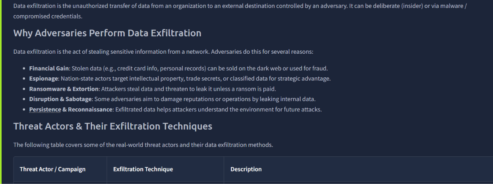
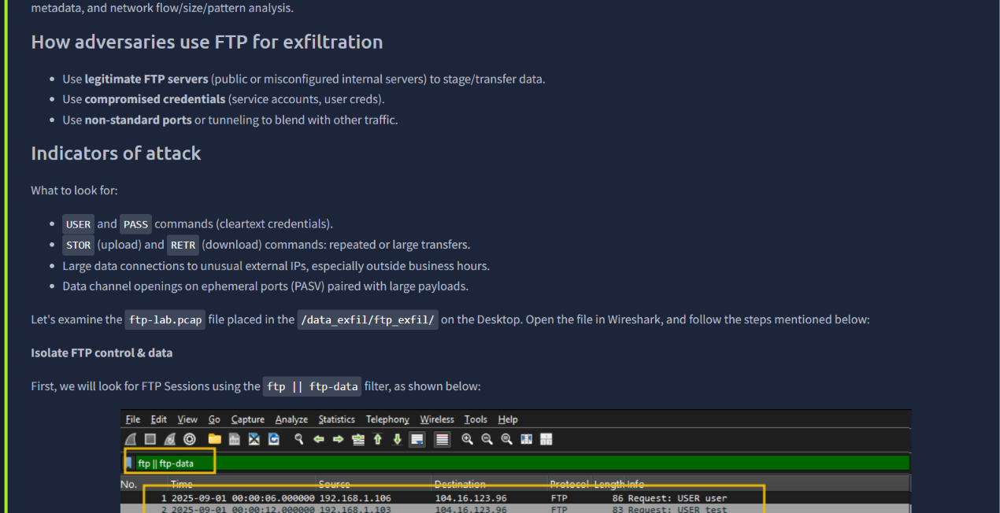
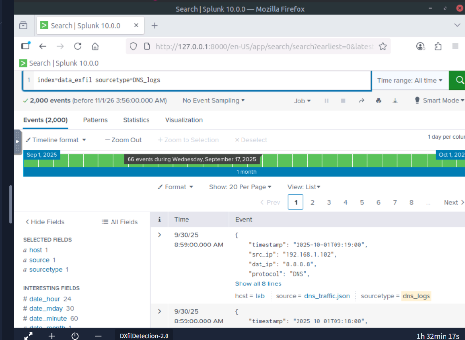
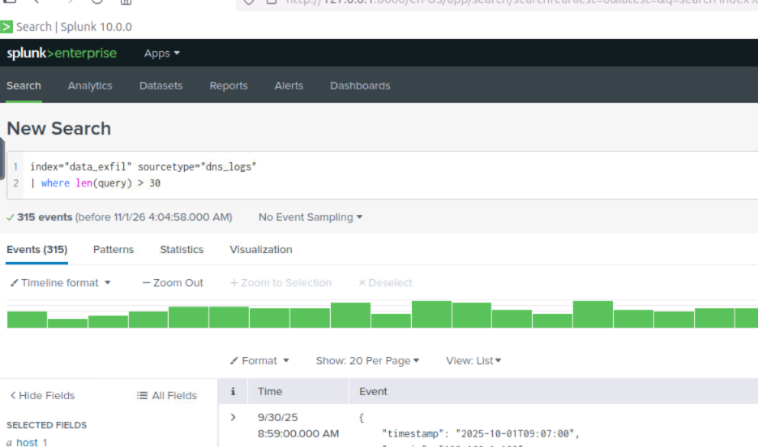
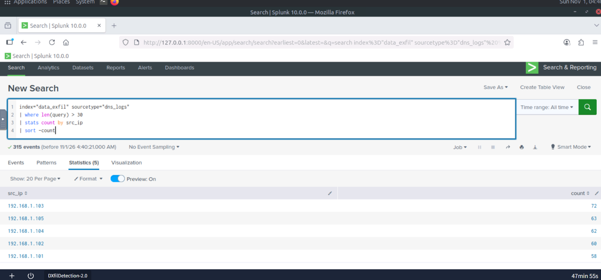
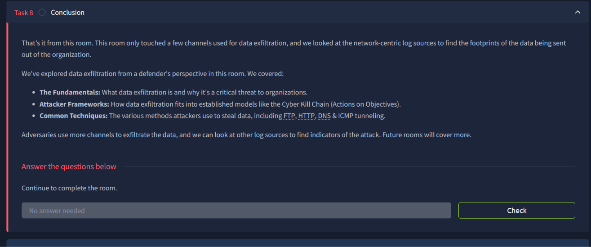

# Network Security Monitoring

## Overview
Learn how to detect data exfiltration attempts in various network channels.

## Topics Covered

## **Data Exfiltration Detection**

*Key concepts:* Data Exfiltration, DNS Tunneling, Stealthy

**What I learned:**

- **Data Exfiltration Techniques:** How threat actors exfiltrate data such as DNS Tunneling, FPS and other ways
- **Why Adversaries Exfiltrate Data:** Data Exfiltration reasons and objectives
- **How to spot Data Exfiltration:** Investigating Data Exfiltration in Wireshark and Splunk

**Why Threat Actors conduct Data Exfiltration**

**FTP Exfiltration**

---

**Splunk DNS Logs query**

**Filtering for DNS with High and malicious query**

---

**Highest Malicious Query using Splunk SIEM**

**Data Exfiltration Room Conclusion

