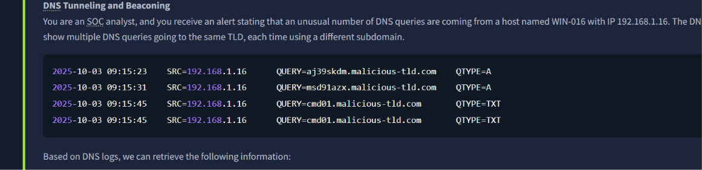
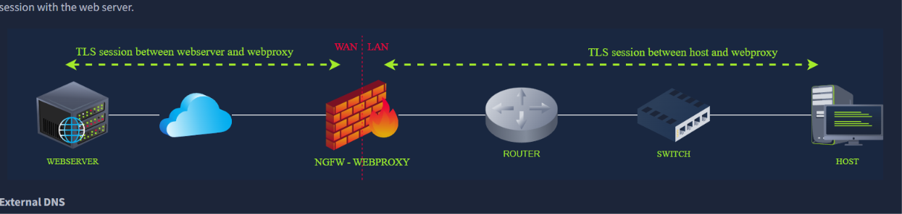
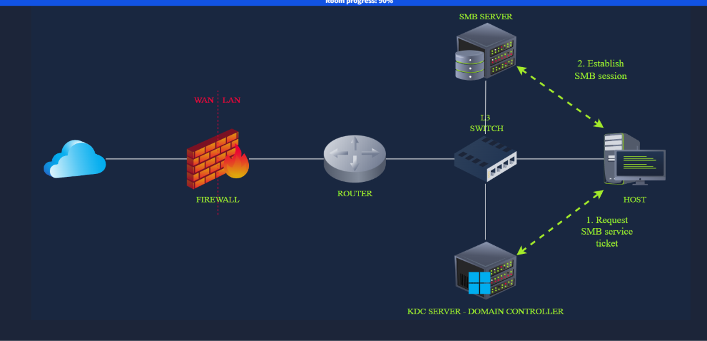
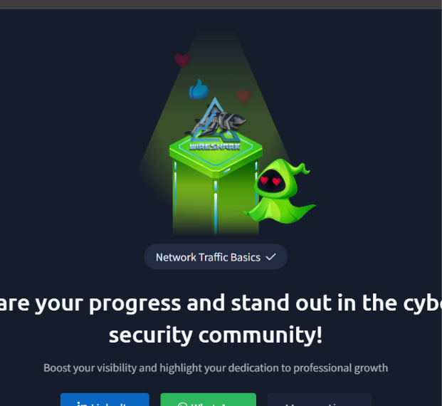
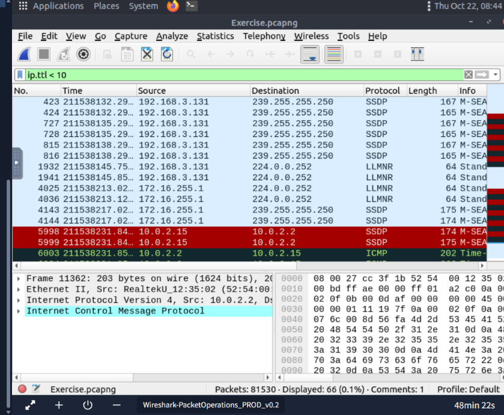
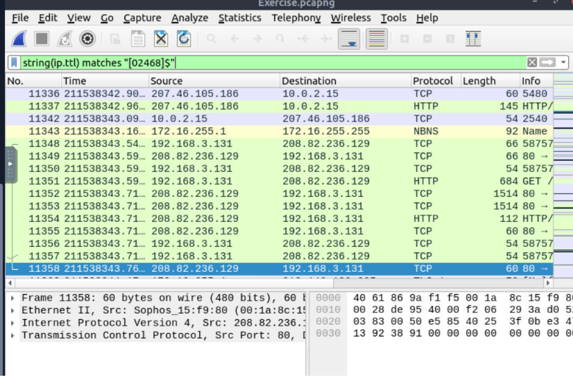

# TryHackMe: Network Traffic Analysis

## Overview
Comprehensive network traffic analysis covering multiple rooms with hands-on investigation techniques

---

# Topics Covered

## Network Traffic Basics

*Key concetps:* NTA source/flow, NTA observation

**What I learned:**
- **Purpose of NTA:** Monitor and investigate attacks deeper in raw packets
- **Common indication or sign of attack:** Attack patterns in network level
- **TCP/IP model:** How data travels to different devices/servers

---

**DNS Tunneling and Beaconing example**

---

**HTTPS with proxy flow**

---

**SMB with Kerberos flow**

---

**Network Traffic Analysis Completion**

---

## Wireshark Packet Operations

*Key concetps:* Packet Filtering, Protocol Filters, Packet investigation

**What I learned:**
- **Wireshark statistics:** Where we can look for certain information closely
- **Packet filtering:** How to filter packet for IP, IPV6, DNS and other protocols
- **Advanced filtering:** Learned how to use complex filtering like regex

---

**Wireshark filtering for IP TTL less than 10**

---

**Getting the total for even number TTL packets**

---

