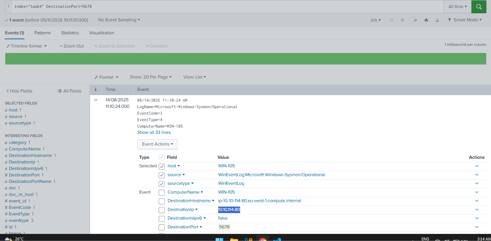
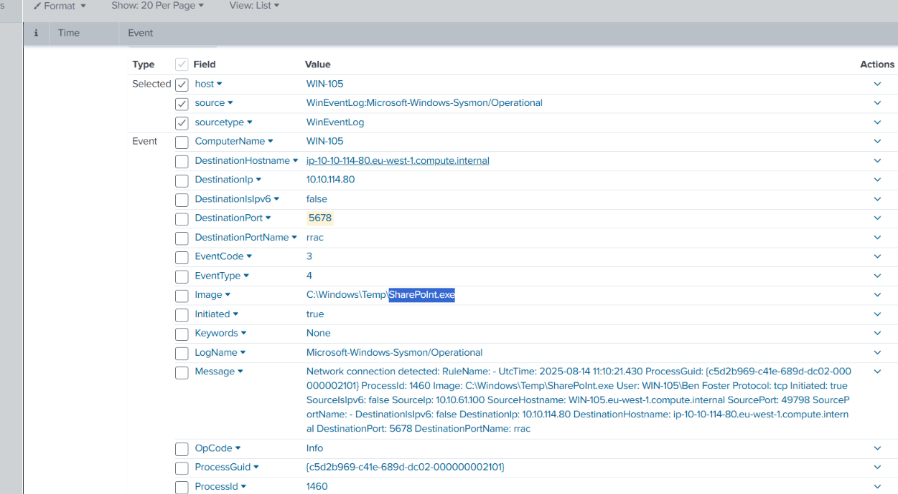
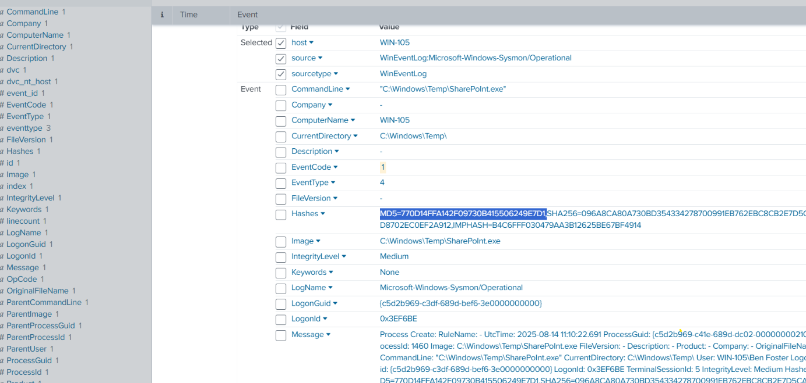
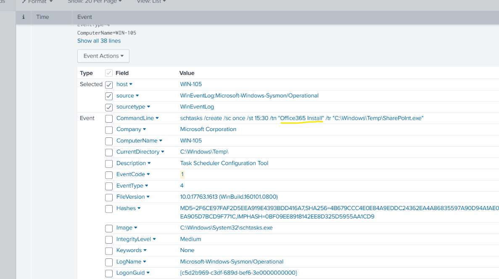

# SIEM Triage for SOC

## Overview
Comprehensive guide on how SIEM solutions can be used to detect and analyse malicious behaviour.

## Topics Covered

## **Log Analysis with SIEM**

*Key concepts:* SIEM, Sysmon, Splunk, Linux/Web Logs

**What I learned:**

- **SIEM solutions:** I learned what is SIEM and how can it helps tremendously when analyzing logs and investigating incidents.
- **Splunk SIEM:** Hands-on simulated real attacks pattern with Splunk.
- **Linux/Web logs:** Hands-on simulated real attacks for Linux/Web logs in Splunk

**IP address of the suspicious destination port of the alert**

**Name of the process that initiated the suspicious alert**

---

**Filtered with EventCode=1 ProcessGuid="{c5d2b969-c41e-689d-dc02-000000002101}" for malicious process MD5 hash**

**Tracked the malicious command in CMD that was created by the process ID above**

---