# Threat Analysis Tools

## Overview

Introducing cyber threat intelligence and related topics, such as relevant standards and frameworks.

## Topics Covered

## **Intro To Cyber Threat Intel**

*Key concepts:*  Cyber Threat Intelligence , Cyber Kill Chain, MITRE ATT&CK

**What I learned:**

- **Turning Raw Data to Usable Intelligence:** Analyzing data, information and intelligence
- **Threat Intelligence Classifications:** Strategic intel, tatic intel, tactical intel and technical intel
- **CTI Standards & Frameworks:** CTI Life cycle, Cyber Kill Chain, MITRE DEFEND

**From Raw Data To Usable Intelligence**

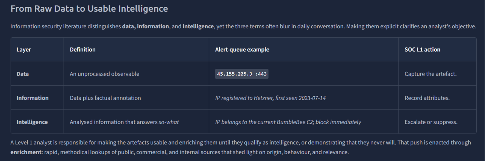

**First Line Triage**

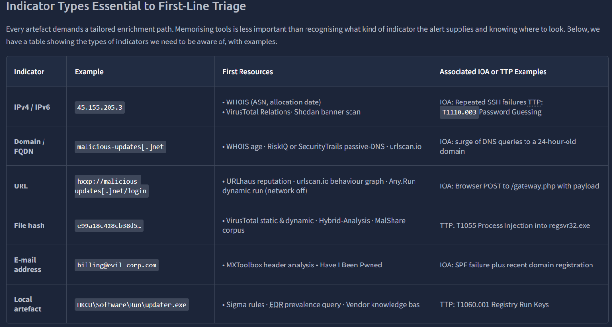

---

**Cyber Threat Intelligence**

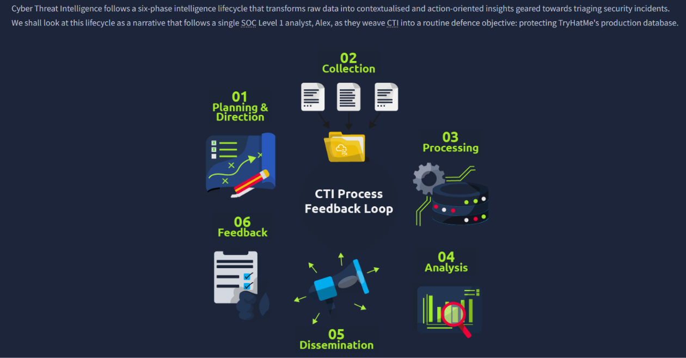

**Cyber Kill Chain Framework**

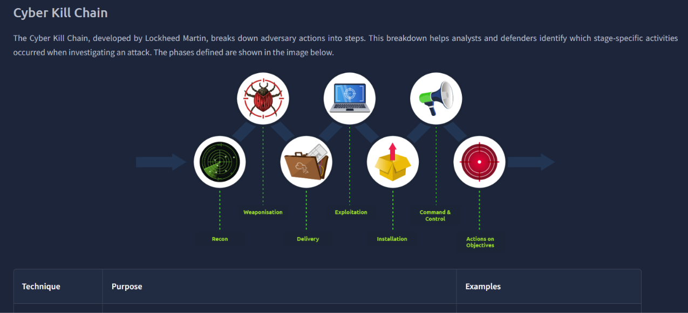

---

**MITRE ATT&CK Framework**

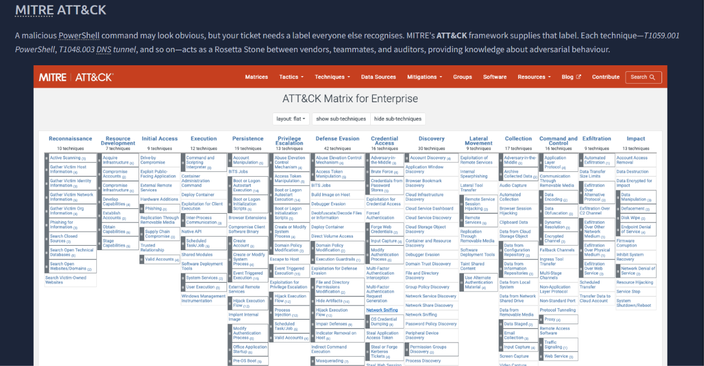

**Hands on CTF with scenario**

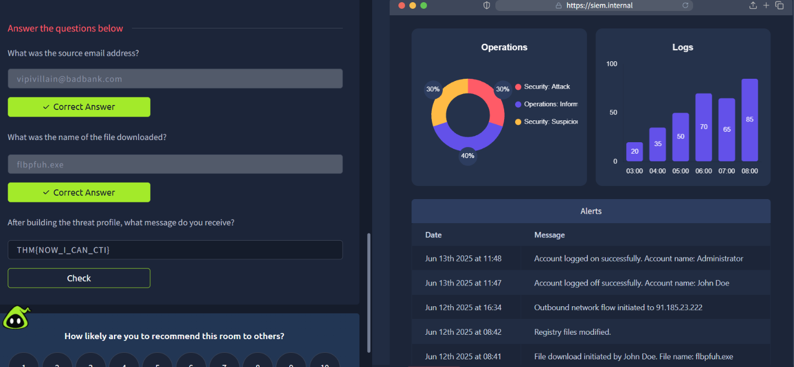

     

## **File and Hash Threat Intel**

*Key concepts:*  Filename/filepath analysis, Filehash lookup, Virustotal/Malwarebazaar

**What I learned:**

- **Filename heuristics:** How to quickly identify potential malicious file for deeper analysis
- **VirusTotal/Malwarebazaar:** How to use VirusTotal and introduction to Malwarebazaar
- **Investigating malicous file:** Steps to do for malicious file analysis

**Computing sha256 hash of bl0gger.exe**

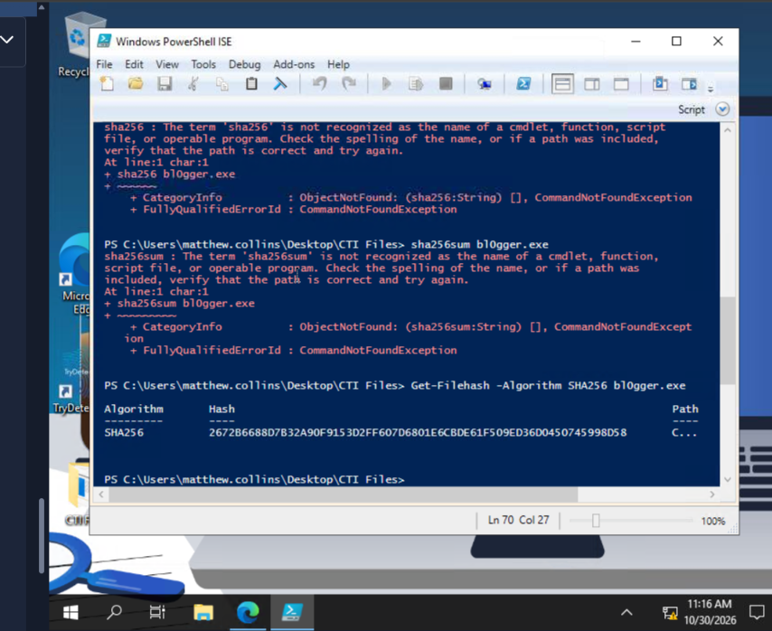

**Learned sha256 commands for Windows and Linux OS**

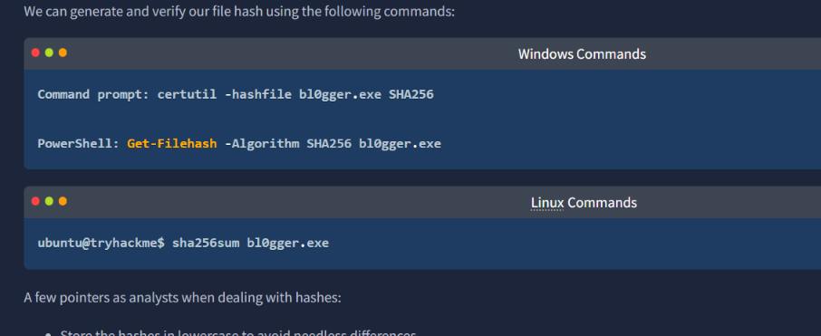

---

**Getting the malware classification of bl0gger.exe**

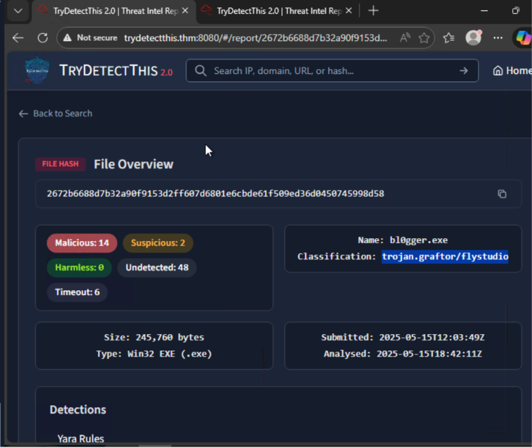

**Filename Heuristic Indicators**

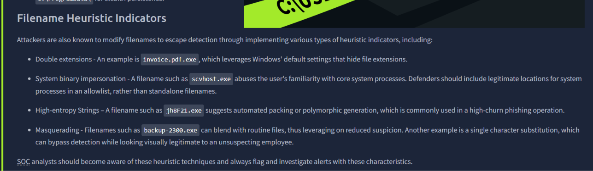

---

**Malwarebazaar**

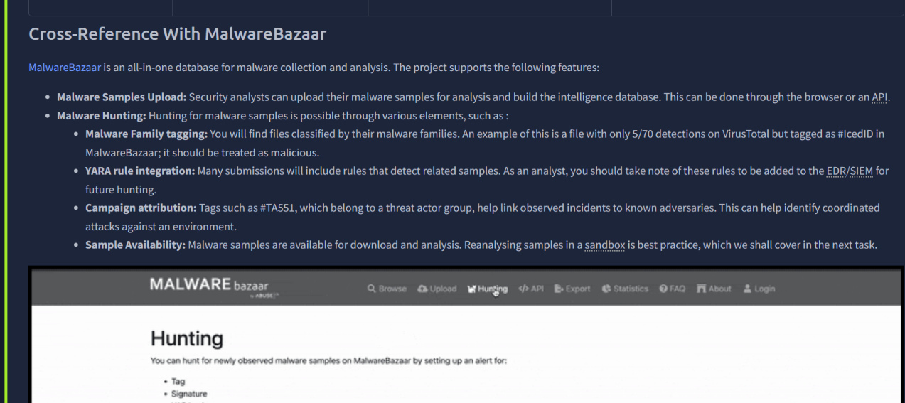

**Sandbox Analysis**

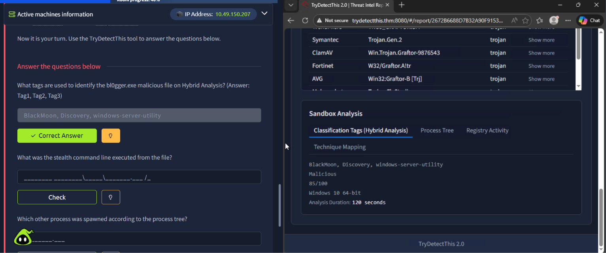

     

## **IP and Domain Threat Intel**

*Key concepts:* IP lookup, domain analysis, and open-source threat intelligence (OSINT).

**What I learned:**

- **Enriching IP and Domain Data:** How to gather actionable insights on IPs and domains using open-source threat intelligence platforms to understand ownership, geolocation, and historic malicious activity.
- **Tools for Analyzing IP and Domain Reputation:** Utilizing specialized tools to assess reputation scores, check public WHOIS registries, and evaluate DNS records to identify potential indicators of compromise (IoCs).
- **VPN Detection and CDN Ranges:** How to distinguish between general user traffic, malicious proxy/VPN configurations, and legitimate Content Delivery Network (CDN) IP ranges to avoid false-positive blocks.

**IP Enrichment in SOC**

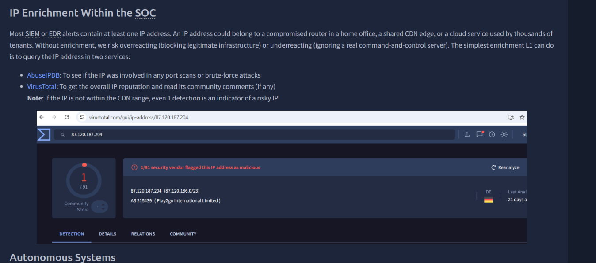

**Using Shodan tool**

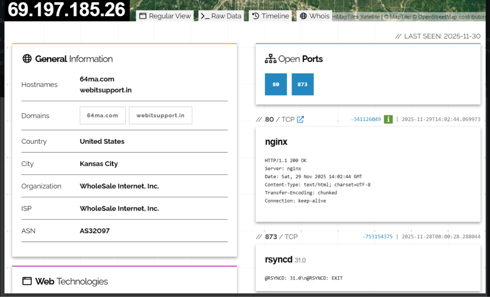

---

**Using Censys to complete the challenge**

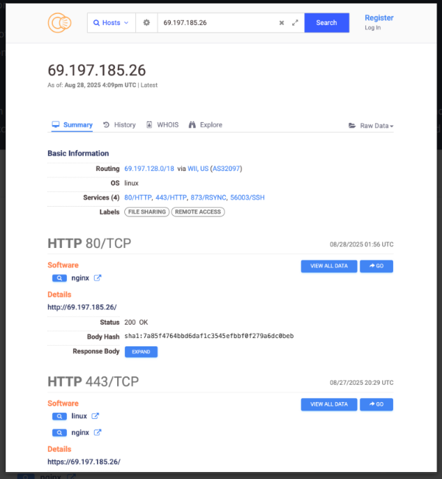

**VPN Detection**

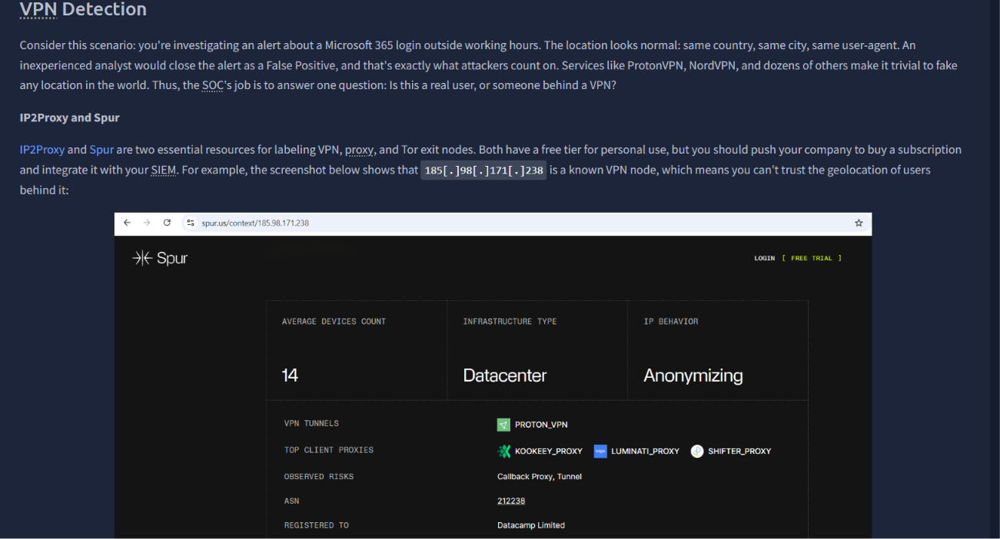

---

**Conclusion of the room**

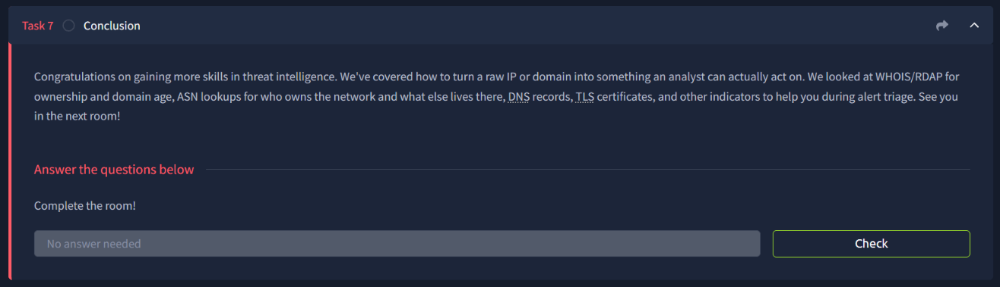

