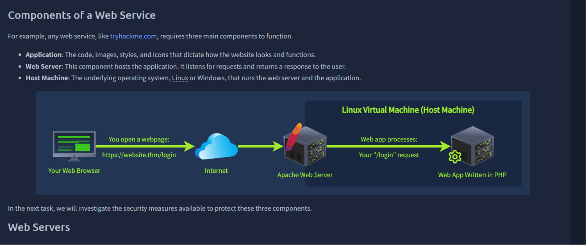
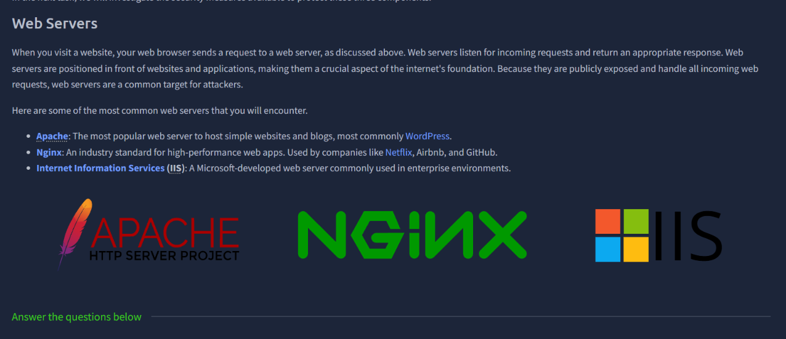
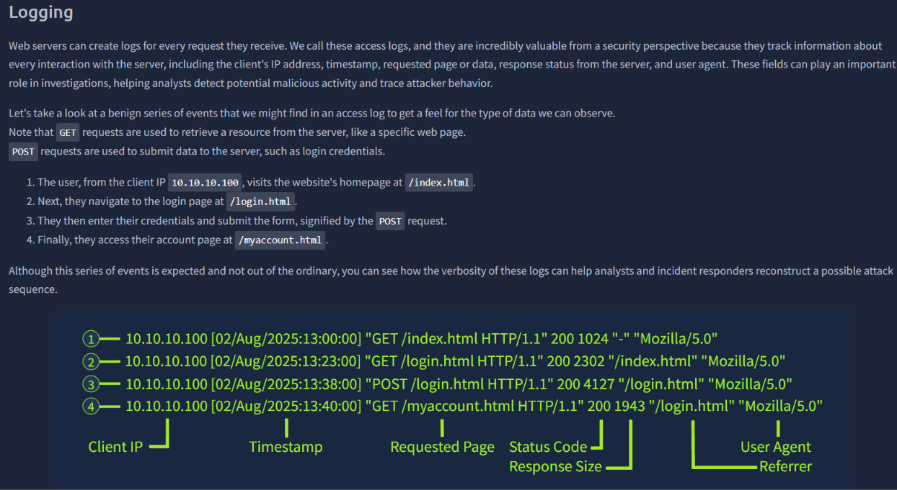
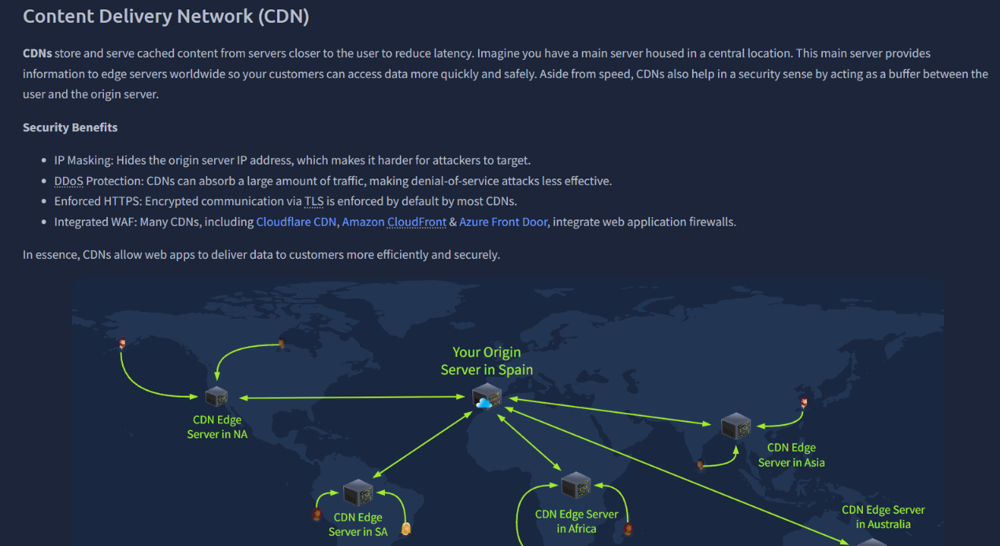
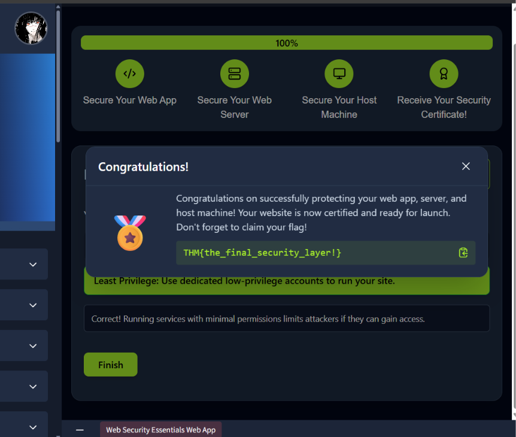
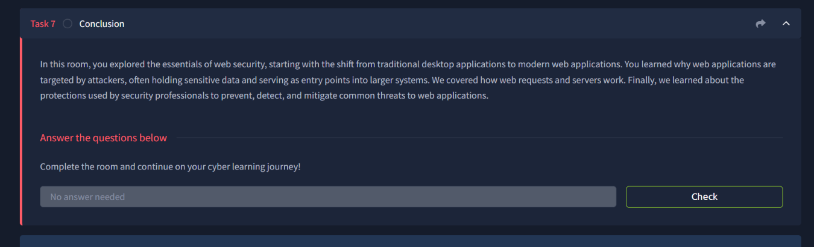

# Web Security Monitoring

## Overview
Comprehensive guide on how to secure and monitor web applications for SOC.

## Topics Covered

## **Web Security Essentials**

*Key concepts:* Web Infrastracture, WAF and CDN

**What I learned:**

- **Web Infrastracture:** Components that make web applications.
- **How to secure web apps:** Setting AntiVirus, WAFs and CDNs to add security layers.
- **Monitoring web apps:** How to look for web app logs and security controls

**Example of a web service components**

**Web Servers examples**

---

**Example of a web logs and how to read it**

**How CDN works and security benefits of it**

---

**Security certificate of a practical challenge**

---

**Web Security Essentials conclusion**

