# Windows Security Monitoring

## Overview
Comprehensive guide on how to look for different log sources including Sysmon and correlating logs for investigation of SOC.

## Topics Covered

## **Windows Logging for SOC**

*Key concepts:* Security Log, Sysmon, Powershell, EventIDs

**What I learned:**

- **Windows log sources:** Different logs generated in Windows including Sysmon
- **Corellating logs:** Log analysis to track attackers' digital footprints
- **Event IDs and Sysmon Event IDs:** Different event IDs to track attacker and hands-on filtering techniques

**Opening EVTX file in notepad**

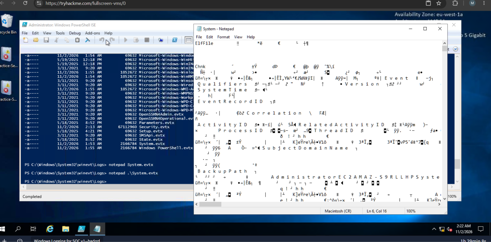

**Event IDs**

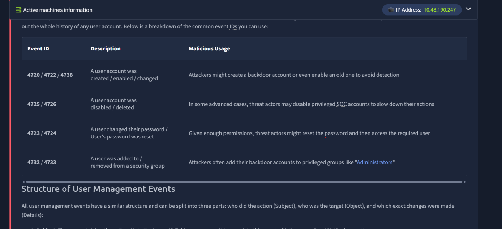

---

**Sarah Miller opened Google Chrome for her browsing and saved malware path**

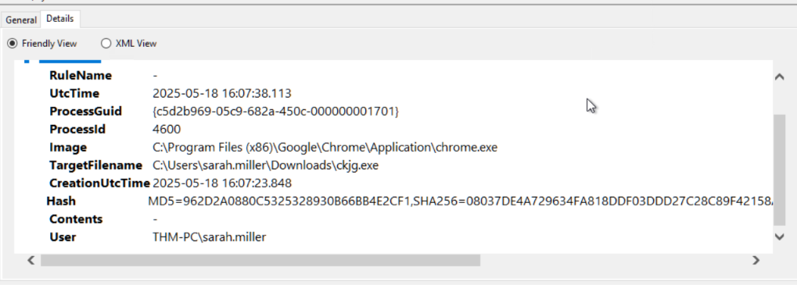

**Bruteforcing logs source IP**

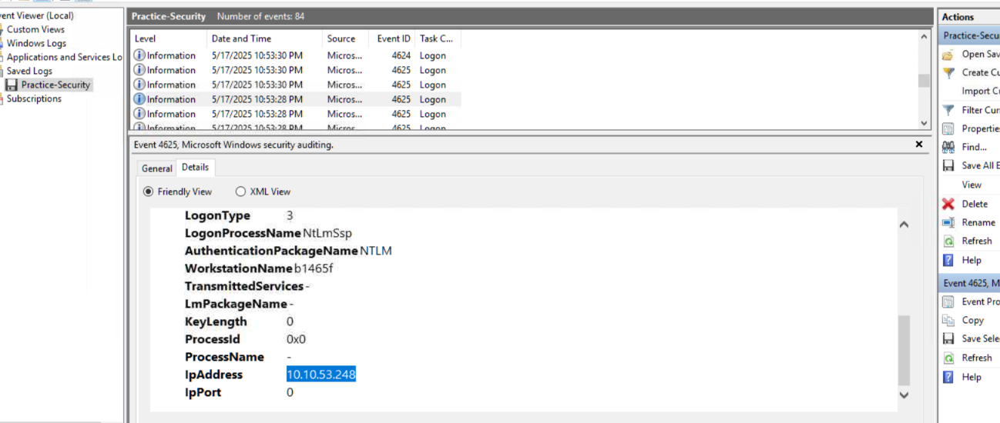

---

**Followed by compromised user: Administrator**

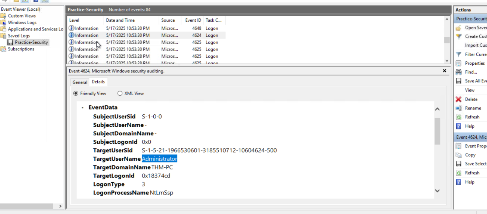

---

**Created new user: svc_sysrestore found in log**

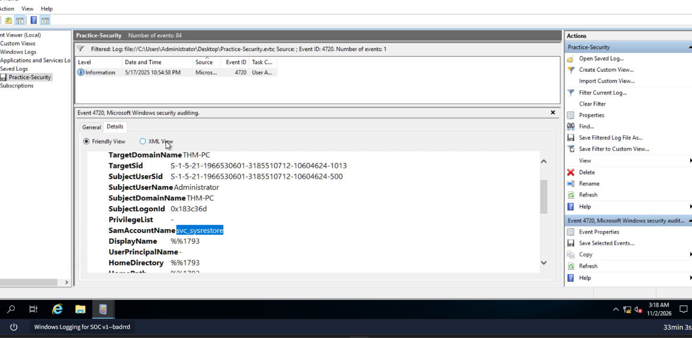

---

**Persistence Path for persistence**

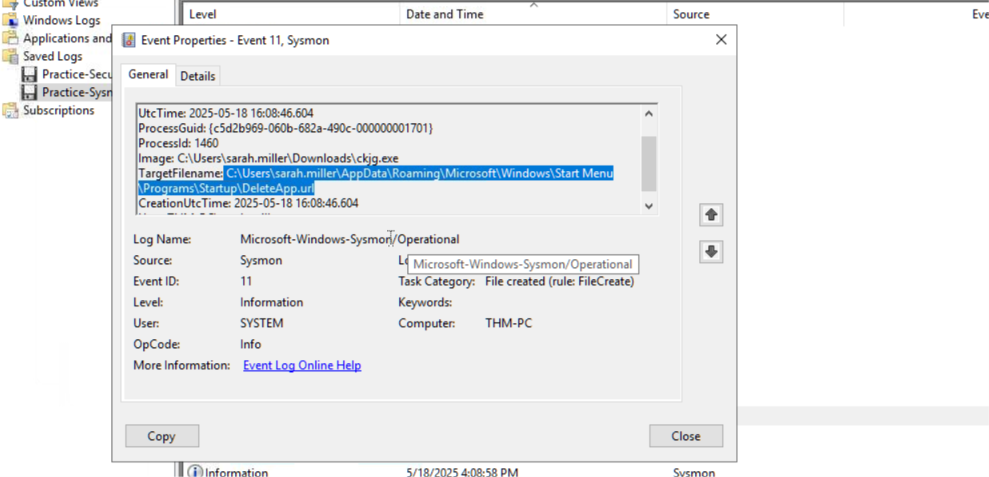

---

**Attacker created user for persistence and added it to group: Backup Operators**

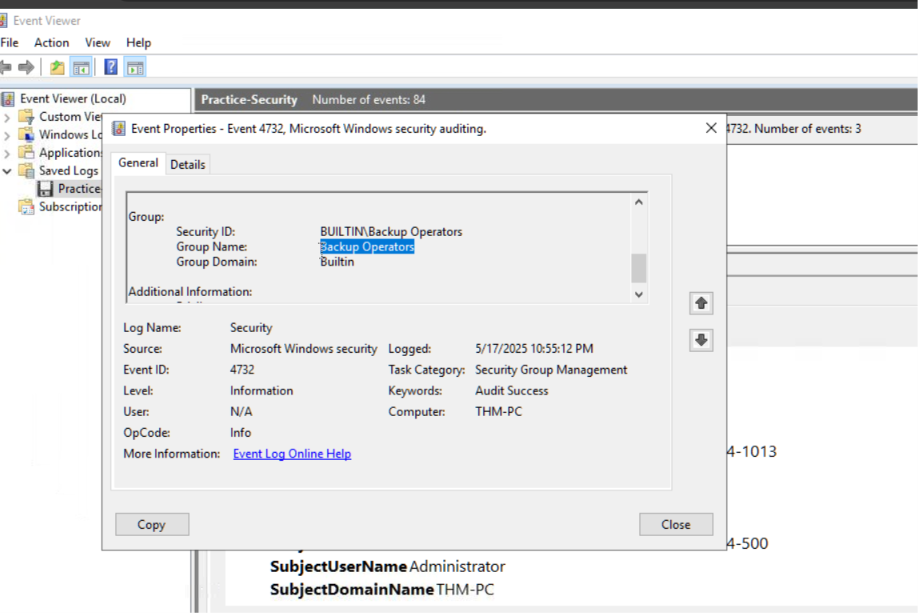

---

**Attacker created user for persistence and added it to group: Remote Desktop Users**

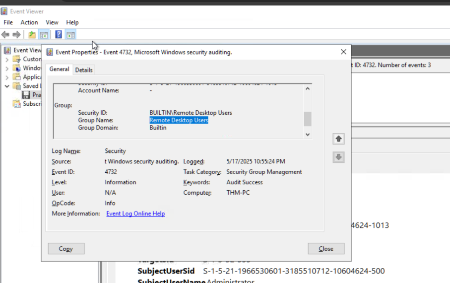

---

**Malware connected to C2 IP**

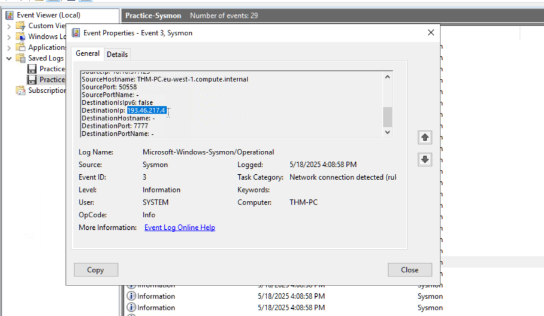

---

**Windows Logging for SOC Conclusion**

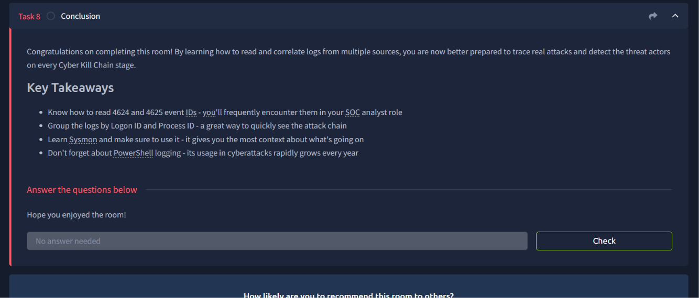

